# Pantry Pop

A cozy recipe manager and meal planner for iPhone.
Paste a link from TikTok, YouTube, Instagram or any recipe site and Pantry Pop turns it into a recipe
you can scale, shop for and cook from. Built with Expo (SDK 58), React Native and TypeScript.

The journey the app is built around: **find a recipe → save it → plan it → buy the ingredients → cook it.**

Your data is saved on the phone. Recipe import uses a small server (a Supabase Edge Function in
[`supabase/`](supabase/)) that keeps the AI key off the phone. **To switch on import and real
payments, follow [SETUP.md](SETUP.md).**

<p>
  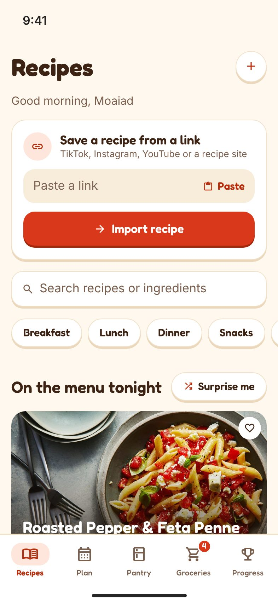
  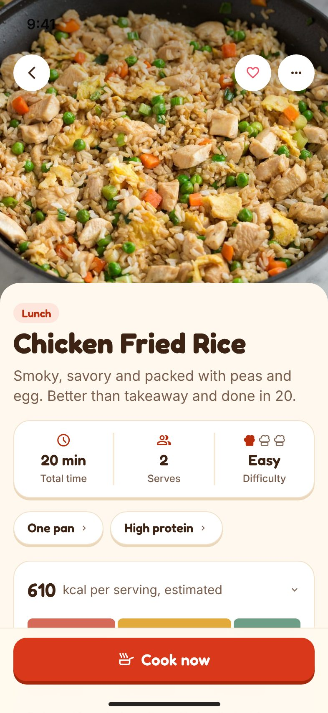
  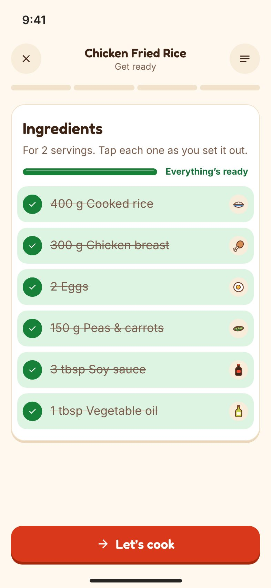
  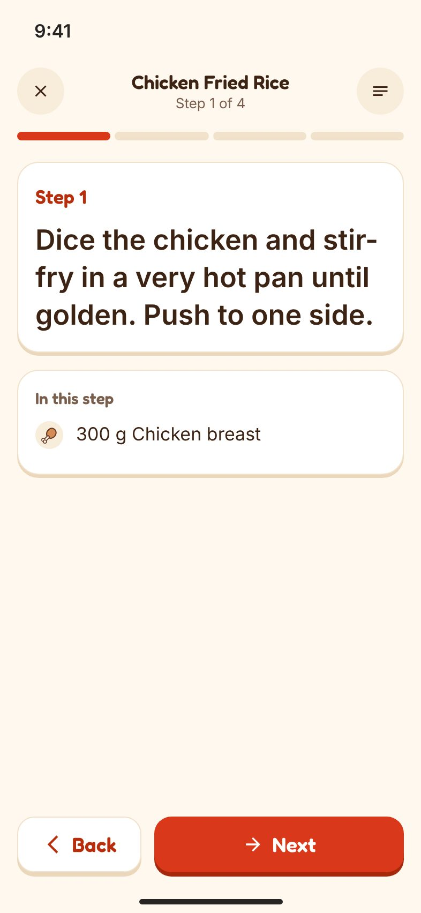
</p>

## The mascot

The app's mascot, Biscuit the chef cat, is **switched off for now** while the final character is being designed.
Every screen shows the mascot only through `<Mascot>` and `<MascotSays>`
([`src/components/mascot/`](src/components/mascot/)), and one switch turns them on or off:
`MASCOT_ON` in [`src/components/mascot/config.ts`](src/components/mascot/config.ts). Turning it back on brings the
mascot back everywhere without redesigning any screen. Mood names are fixed so a Rive file can replace the art later.

## Import recipes from links

<p>
  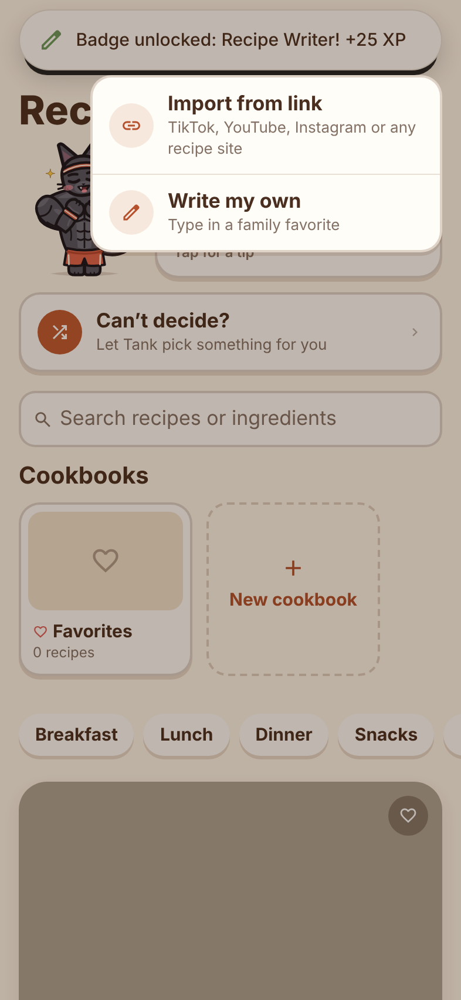
  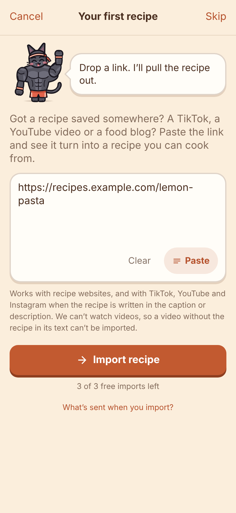
  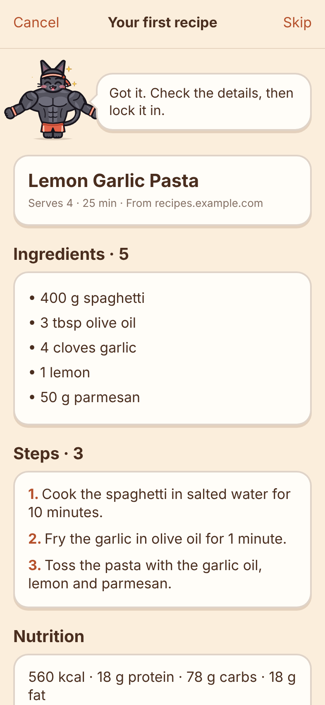
</p>

Tap **+** on the Recipes tab, choose **Import from link**, paste a link (or the caption text) and check the result before saving.

- **Recipe websites:** the page's own recipe data (schema.org JSON-LD) is read first, since it's the most reliable.
- **TikTok, YouTube, Instagram:** the public caption or description. Pantry Pop can't watch videos. When a video's text doesn't include the recipe, it says so and offers to paste the text or write it yourself.
- **AI extraction:** Claude turns the text into a strict structure: title, servings, time, ingredients (amount, unit, name), steps and tags. Every ingredient is checked against the source text and dropped if it isn't there.
- **Nutrition:** always marked as an estimate per serving: the site's own numbers when it gives them, otherwise estimated from the ingredients.
- **When something's missing:** the edit form opens pre-filled and says exactly what to fill in. It never fails silently, and offline, timeout and rate-limit cases each get a clear message.
- **The server:** rate limits per device and per IP, a daily cap on AI calls, a 7-day cache per link, and private network addresses blocked. Details are in [SETUP.md](SETUP.md).
- **Free vs Pro:** 3 imports free, unlimited with Pro.

## Pantry: what can I cook?

<p>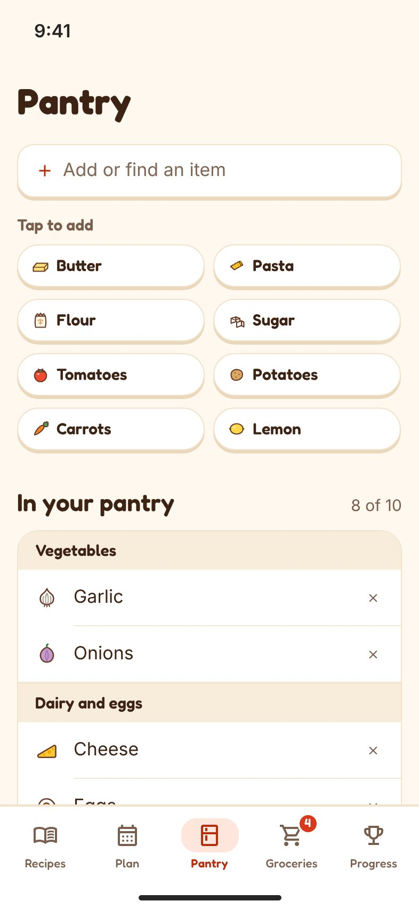 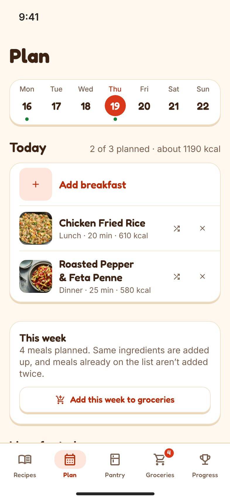 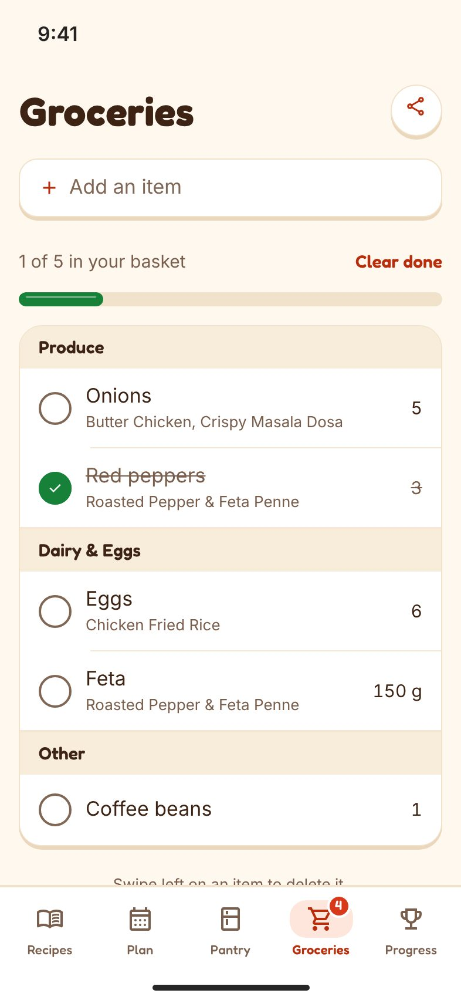 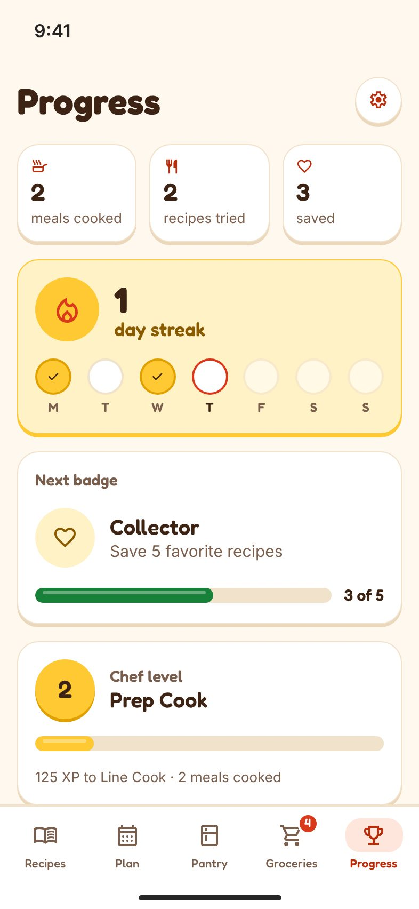</p>

Add what you have (common items are one tap, or type to search). **What can I cook?** ranks recipes by how much you already
have, shows "Missing: …" on each, and adds the missing items to Groceries in one tap. Salt, pepper and water are assumed.
Free: up to 10 items. Pro: unlimited, plus **Buy one thing, cook more**, which shows the single item that completes the most recipes.

## Features

- **Recipes (home):** a paste-a-link import box, search by name or ingredient, category and diet filters, "on the menu tonight" (or a recipe of the day), rows for Cook again, Recently saved and Quick meals (shown only when there's data), and all recipes sorted your way (suggested, recently cooked, quickest, A to Z)
- **Cookbooks:** Favorites plus your own collections; save any recipe to several cookbooks
- **Write your own recipe:** photo, link to the original, ingredients one per line (amounts are understood), steps, tags
- **Recipe page:** servings scaling, metric/US units (including oven temperatures), estimated nutrition per serving (folds away), "Have it" tags for what's in your pantry, add all or only the missing ingredients to groceries, personal notes, share
- **Cook Mode:** an ingredient checklist first, then one large step at a time with the screen kept on, the ingredients each step uses, timers picked up from the steps ("bake for 25 minutes"), several at once, a tappable step bar and the full ingredient list one tap away. Going back never loses progress. Log the meal at the end.
- **Timers that keep going:** they survive leaving Cook Mode and closing the app. With a development build they ring as a time-sensitive notification when the phone is locked, and show on the Lock Screen and in the Dynamic Island with a live countdown (see [TIMERS.md](TIMERS.md); Expo Go rings only while the app is open).
- **Meal plan:** a week view with breakfast, lunch and dinner, change a meal in one tap, estimated calories per day, and one tap to add the whole week to your list. That button is safe to press again: each planned meal is added once per week, and your own items and edits are never overwritten.
- **Groceries:** grouped by aisle, the same ingredient from different recipes added up ("2 onions" + "3 onions" = 5; units are never converted), tick off (ticked items move down), swipe to delete, add your own items, share the list
- **Pantry:** your items grouped into kitchen categories, and "What can I cook?" ranked by what you already have
- **Progress:** milestones (meals cooked, recipes tried, saved), a gentle cooking streak, chef level and badges, daily goals (Pro), and your cooking history. Settings (units, light or dark) are behind the gear.
- **Just for fun:** "Surprise me" shuffles through recipes and picks one (it respects your diet and filters). You earn XP for cooking, adding recipes and finishing lists, level up from Kitchen Kitten to Legendary Chef, unlock badges, and get confetti when you finish a meal.

## Onboarding and Pro

<p>
  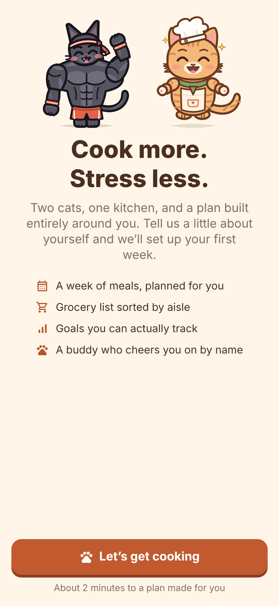
  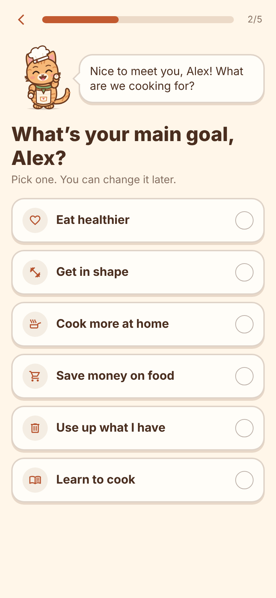
  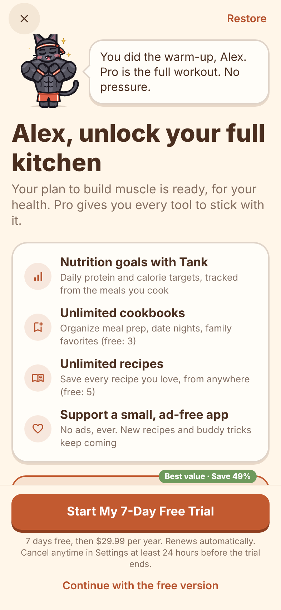
</p>

Four quick questions: name, main goal, diet, and how many you cook for. Then you **import your
first recipe** (skippable), so you see the app work on something of yours **before** any price. Then the paywall,
which you can close or skip with "Continue with the free version".

The paywall is honest: a headline that matches why it opened, benefits ordered by your goal, a preselected yearly
plan with truthful per-week pricing, a clear trial timeline, and the full price and renewal terms next to the button.
No fake timers, invented reviews, guilt-tripping, or hidden prices and close buttons (App Store guideline 3.1.2 and EU consumer law).

| Free | Pro ($29.99/year with a 7-day free trial, or $4.99/month) |
| --- | --- |
| 3 imports | Unlimited imports |
| Pantry up to 10 items | Unlimited pantry + smart suggestions |
| 5 handwritten recipes, 3 cookbooks | Unlimited recipes and cookbooks |
| Nutrition shown on every recipe | Daily nutrition goals and tracking |

Payments run in **test mode** (nothing is charged, the paywall says so). Real purchases go through RevenueCat
([`src/lib/revenuecat.ts`](src/lib/revenuecat.ts)) and are switched on with one setting,
`EXPO_PUBLIC_PURCHASES_MODE=revenuecat`, after the App Store Connect and RevenueCat steps in [SETUP.md](SETUP.md).
Limits are in `FREE_LIMITS` ([`src/state/store.tsx`](src/state/store.tsx)), prices in [`src/lib/purchases.ts`](src/lib/purchases.ts).

## Honesty notes

- New users start with an empty plan, list and cookbooks: no pretend data.
- Sample recipe nutrition was checked against the listed ingredients (Nov 2026). Cooking oil the steps used was added to the ingredient lists, and the numbers were recomputed where they were clearly off. All nutrition is labelled "estimated per serving".
- No fake loading screens or "up to date" refreshes.
- A placeholder Privacy screen explains exactly what is sent when you import. Have it reviewed before release.

## Run it

```bash
npm install
npx expo start
```

Scan the QR code with the Camera app to open it in Expo Go on your iPhone, or press `i` for the iOS Simulator (macOS only).
Without `EXPO_PUBLIC_IMPORT_URL` set, import shows a clear "not connected yet" message; see [SETUP.md](SETUP.md).

Tests: `node --test scripts/groceries.test.ts scripts/qty.test.ts scripts/timers.test.ts scripts/foodKind.test.ts` (app logic),
`node --test scripts/import.test.ts` (import backend, offline), `node scripts/test-import.ts` (10 real links).

## Project layout

```
src/
  app/                   Screens (Expo Router: every file is a route)
    (tabs)/              Recipes, Plan, Pantry, Groceries and Progress
    onboarding.tsx       Four quick questions      import.tsx   Import from a link
    paywall.tsx          Pro                       privacy.tsx  Privacy policy (placeholder)
    recipe/[id].tsx      Recipe page          recipe/new.tsx   Add your own recipe
    cook/[id].tsx        Cook Mode            cookbook/[id].tsx  A cookbook
    plan-picker.tsx, save-to-cookbook.tsx, cookbook-edit.tsx   Sheets
  components/
    mascot/              The mascot (switched off for now): art, rig, moods, lines, MASCOT_ON switch
    cats/                The old two-cat buddies, no longer used by any screen
  data/mock.ts           Mock recipes, grocery list, plan and cookbooks
  state/store.tsx        App state, saved on the device
  lib/                   Import client, pantry matching and categories, grocery list math, purchases (mock | RevenueCat), units, timers
  config.ts              EXPO_PUBLIC_* settings (no secrets)
supabase/
  functions/import-recipe/   The import server (fetching, JSON-LD, Claude, limits)
  migrations/            Rate-limit and cache tables
scripts/                 Tests, import dev server, 10-link test
src/theme/index.ts       All colours, type, spacing, radius and motion
```

## Changing the look

Everything visual lives in [`src/theme/index.ts`](src/theme/index.ts): the cozy light and dark palettes,
the type scale (Fredoka for titles and buttons, the system font for reading), spacing, corner radius, the chunky card and
button styles, and animation springs. [DESIGN.md](DESIGN.md) describes the design and what not to change.

## Platform notes

The app is designed for iOS. The tab bar, large titles, header search, sheets, haptics and swipe-back are native iOS components,
so they look and behave fully native only on an iPhone. Android and web get working equivalents.

The iOS share sheet ("Share → Pantry Pop") isn't built yet: it needs a native share extension and a development build. The app already opens `pantrypop://import?url=…` links. See SETUP.md.

## Placeholder photos

The recipe photos in `assets/recipes/` are placeholders from the MIT-licensed
[Foodish](https://github.com/surhud004/Foodish) project, cropped and resized.
Replace them with your own photography before publishing the app.
