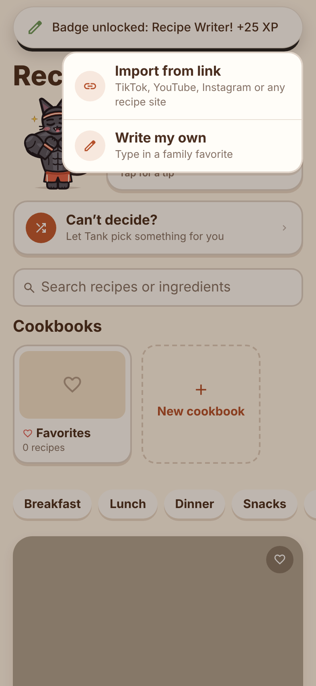
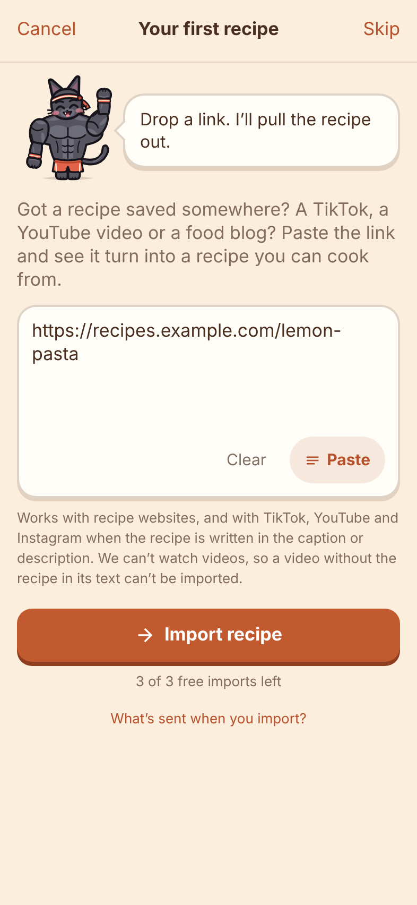
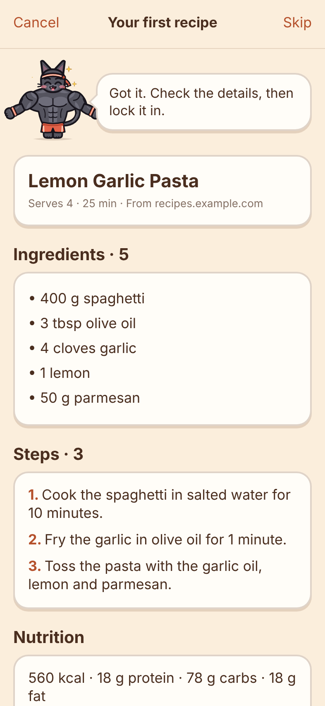
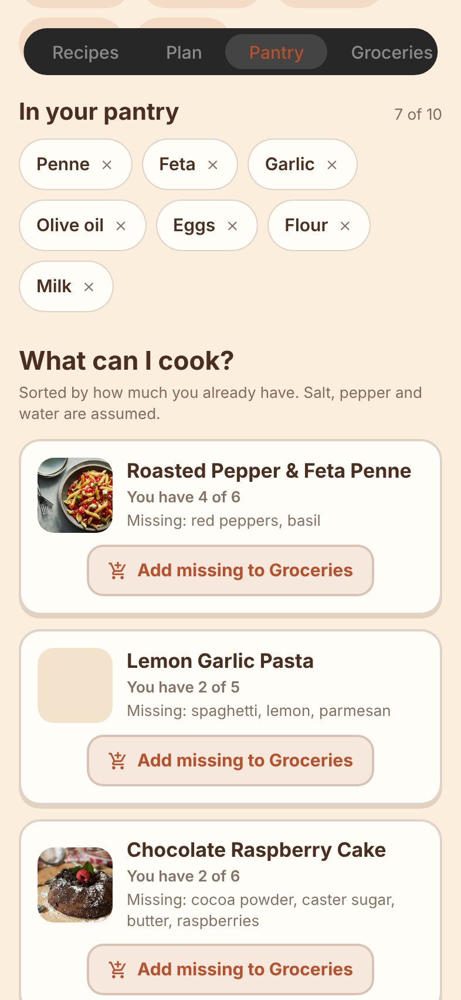
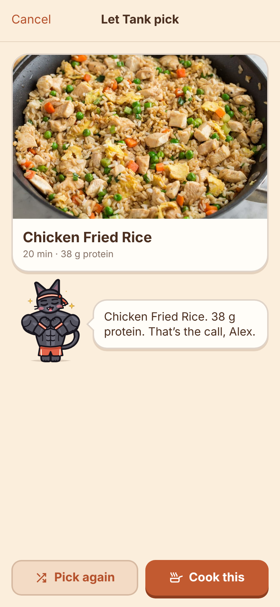
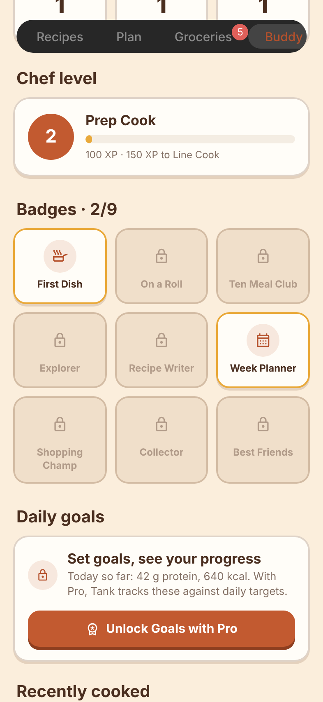
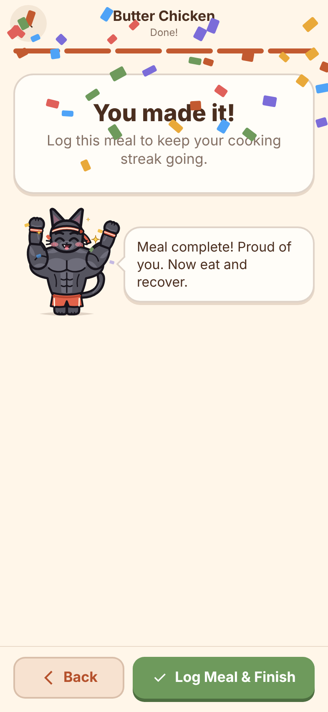

# Pantry Pop

A cozy recipe manager and meal planner for iPhone, where a cat helps you cook.
Paste a link from TikTok, YouTube, Instagram or any recipe site and Pantry Pop turns it into a recipe
you can scale, shop for and cook from. Built with Expo (SDK 58), React Native and TypeScript.

Your data is saved on the phone. Recipe import uses a small server (a Supabase Edge Function in
[`supabase/`](supabase/)) that keeps the AI key off the phone. **To switch on import and real
payments, follow [SETUP.md](SETUP.md).**

<p>
  
  
  
  
</p>

## Your kitchen buddy

Pick one of two cats when you first open the app. You can switch anytime from the Buddy tab.

| | Personality | Helps with |
| --- | --- | --- |
| **Coach Tank** | Tough but kind. Short sentences, counts everything in reps, never shames food, respects rest days. Secretly soft: gets flustered when you pet him and has a weakness for cookies. | Getting in shape: protein on every card, macros, daily protein and calorie goals, protein tips |
| **Chef Biscuit** | Funny, sweet and clumsy. Drops things, "taste tests" half the ingredients, makes terrible puns, naps in sunny spots. | Making cooking cozy: kitchen tips, encouragement, jokes |

The cats are original vector drawings, rigged like puppets: arms bend at the shoulder and elbow, the tail swishes,
eyes blink and the mouth moves while they talk. Every line they say is tagged with a mood, so the animation matches the words.
For example, Tank flexes when a recipe is high in protein, Biscuit gets a sweat drop when a step says "hot pan", and both stir a bowl during a stirring step.
Tap a cat to pet it.

## Import recipes from links

<p>
  
  
  
</p>

Tap **+** on the Recipes tab, choose **Import from link**, paste a link (or the caption text) and check the result before saving.

- **Recipe websites:** the page's own recipe data (schema.org JSON-LD) is read first, since it's the most reliable.
- **TikTok, YouTube, Instagram:** the public caption or description. Pantry Pop can't watch videos. When a video's text doesn't include the recipe, it says so and offers to paste the text or write it yourself.
- **AI extraction:** Claude turns the text into a strict structure: title, servings, time, ingredients (amount, unit, name), steps and tags. Every ingredient is checked against the source text and dropped if it isn't there.
- **Nutrition:** always marked as an estimate per serving: the site's own numbers when it gives them, otherwise estimated from the ingredients.
- **When something's missing:** the edit form opens pre-filled and says exactly what to fill in. It never fails silently, and offline, timeout and rate-limit cases each get a clear message.
- **The server:** rate limits per device and per IP, a daily cap on AI calls, a 7-day cache per link, and private network addresses blocked. Details are in [SETUP.md](SETUP.md).
- **Free vs Pro:** 3 imports free, unlimited with Pro.

## Pantry: what can I cook?

<p></p>

Add what you have (common items are one tap, or type to search). **What can I cook?** ranks recipes by how much you already
have, shows "Missing: …" on each, and adds the missing items to Groceries in one tap. Salt, pepper and water are assumed.
Free: up to 10 items. Pro: unlimited, plus **Buy one thing, cook more**, which shows the single item that completes the most recipes.

## Features

- **Recipes:** search, category and diet filters, photo grid, featured "on the menu tonight" (or a recipe of the day)
- **Cookbooks:** Favorites plus your own collections; save any recipe to several cookbooks
- **Write your own recipe:** photo, link to the original, ingredients one per line (amounts are understood), steps, tags
- **Recipe page:** servings scaling, metric/US units (including oven temperatures), estimated nutrition per serving, personal notes, share, buddy comments
- **Cook Mode:** step by step with the screen kept on, timers picked up from the steps ("bake for 25 minutes") that ring with a chime and vibration until you tap Stop, and your buddy acting out each step. Log the meal at the end.
- **Meal plan:** a week view with breakfast, lunch and dinner, a daily nutrition summary, and one tap to add the whole week to your list
- **Groceries:** grouped by aisle, combined across recipes, tick off, swipe to delete, add your own items, share the list
- **Buddy tab:** tricks, switch buddy, cooking streak and stats, chef level and badges, daily goals, units
<p>
  
  
  
</p>

- **Just for fun:** "Can't decide?" lets your buddy shuffle through recipes and pick dinner (it respects your diet and filters). You earn XP for cooking, adding recipes, finishing lists and petting your buddy, level up from Kitchen Kitten to Legendary Chef, unlock 9 badges, and get confetti when you finish a meal.

## Onboarding and Pro

<p>
  
  
  
  
</p>

Five quick screens: name, main goal, diet, how many you cook for, and your buddy. Then you **import your
first recipe** (skippable), so you see the app work on something of yours **before** any price. Then the paywall,
which you can close or skip with "Continue with the free version".

The paywall is honest: a headline that matches why it opened, benefits ordered by your goal, a preselected yearly
plan with truthful per-week pricing, a clear trial timeline, and the full price and renewal terms next to the button.
No fake timers, invented reviews, guilt-tripping, or hidden prices and close buttons (App Store guideline 3.1.2 and EU consumer law).

| Free | Pro ($29.99/year with a 7-day free trial, or $4.99/month) |
| --- | --- |
| 3 imports | Unlimited imports |
| Pantry up to 10 items | Unlimited pantry + smart suggestions |
| 5 handwritten recipes, 3 cookbooks | Unlimited recipes and cookbooks |
| Nutrition shown on every recipe | Daily nutrition goals and tracking |

Payments run in **test mode** (nothing is charged, the paywall says so). Real purchases go through RevenueCat
([`src/lib/revenuecat.ts`](src/lib/revenuecat.ts)) and are switched on with one setting,
`EXPO_PUBLIC_PURCHASES_MODE=revenuecat`, after the App Store Connect and RevenueCat steps in [SETUP.md](SETUP.md).
Limits are in `FREE_LIMITS` ([`src/state/store.tsx`](src/state/store.tsx)), prices in [`src/lib/purchases.ts`](src/lib/purchases.ts).

## Honesty notes

- New users start with an empty plan, list and cookbooks: no pretend data.
- Sample recipe nutrition was checked against the listed ingredients (Nov 2026). Cooking oil the steps used was added to the ingredient lists, and the numbers were recomputed where they were clearly off. All nutrition is labelled "estimated per serving".
- No fake loading screens or "up to date" refreshes.
- A placeholder Privacy screen explains exactly what is sent when you import. Have it reviewed before release.

## Run it

```bash
npm install
npx expo start
```

Scan the QR code with the Camera app to open it in Expo Go on your iPhone, or press `i` for the iOS Simulator (macOS only).
Without `EXPO_PUBLIC_IMPORT_URL` set, import shows a clear "not connected yet" message; see [SETUP.md](SETUP.md).

Tests: `node --test scripts/import.test.ts` (import backend, offline), `node scripts/test-import.ts` (10 real links).

## Project layout

```
src/
  app/                   Screens (Expo Router: every file is a route)
    (tabs)/              Recipes, Plan, Pantry, Groceries and Buddy
    onboarding.tsx       Five quick questions      import.tsx   Import from a link
    paywall.tsx          Pro                       privacy.tsx  Privacy policy (placeholder)
    recipe/[id].tsx      Recipe page          recipe/new.tsx   Add your own recipe
    cook/[id].tsx        Cook Mode            cookbook/[id].tsx  A cookbook
    plan-picker.tsx, save-to-cookbook.tsx, cookbook-edit.tsx   Sheets
  components/
    cats/                The buddies: art, animation rig, moods, dialogue, speech bubble
  data/mock.ts           Mock recipes, grocery list, plan and cookbooks
  state/store.tsx        App state, saved on the device
  lib/                   Import client, pantry matching, purchases (mock | RevenueCat), units, timers
  config.ts              EXPO_PUBLIC_* settings (no secrets)
supabase/
  functions/import-recipe/   The import server (fetching, JSON-LD, Claude, limits)
  migrations/            Rate-limit and cache tables
scripts/                 Import tests, dev server, 10-link test
  theme/index.ts         All colours, type, spacing, radius and motion
```

## Changing the look

Everything visual lives in [`src/theme/index.ts`](src/theme/index.ts): the cozy light and dark palettes,
Apple's text styles (headings use SF Pro Rounded), spacing, corner radius, the chunky card and button styles, and animation springs.
The cats' colours live with their artwork in [`src/components/cats/art.tsx`](src/components/cats/art.tsx),
and what they say lives in [`src/components/cats/dialogue.ts`](src/components/cats/dialogue.ts).

## Platform notes

The app is designed for iOS. The tab bar, large titles, header search, sheets, haptics and swipe-back are native iOS components,
so they look and behave fully native only on an iPhone. Android and web get working equivalents.

The iOS share sheet ("Share → Pantry Pop") isn't built yet: it needs a native share extension and a development build. The app already opens `pantrypop://import?url=…` links. See SETUP.md.

## Placeholder photos

The recipe photos in `assets/recipes/` are placeholders from the MIT-licensed
[Foodish](https://github.com/surhud004/Foodish) project, cropped and resized.
Replace them with your own photography before publishing the app.
