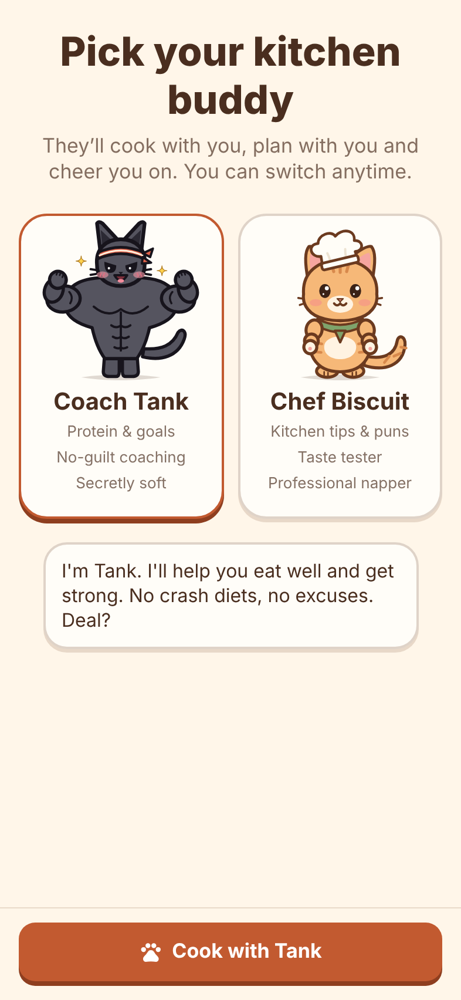
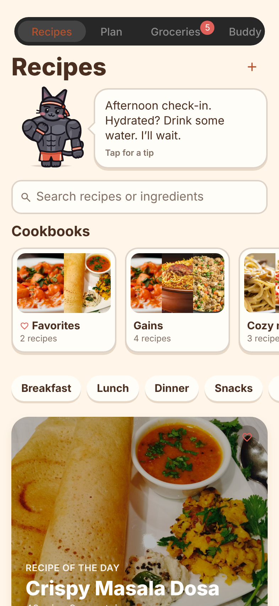
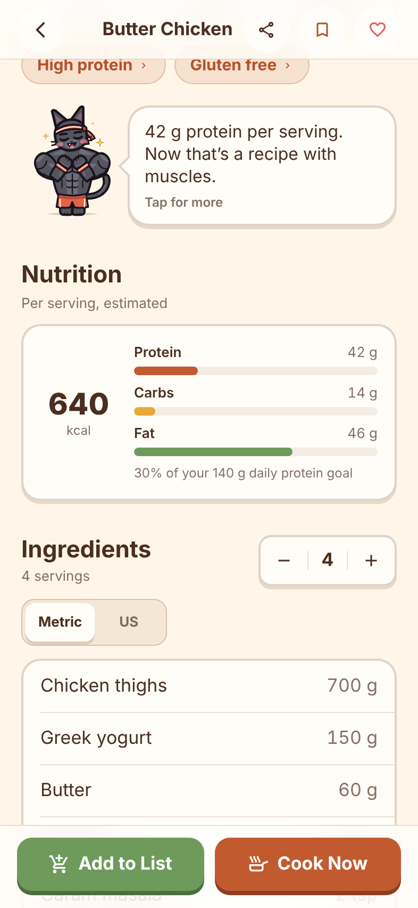
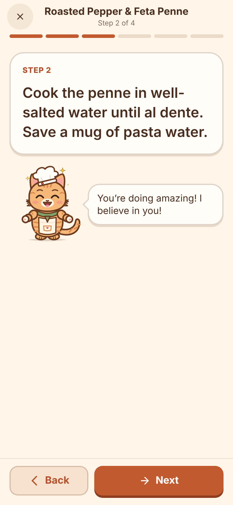
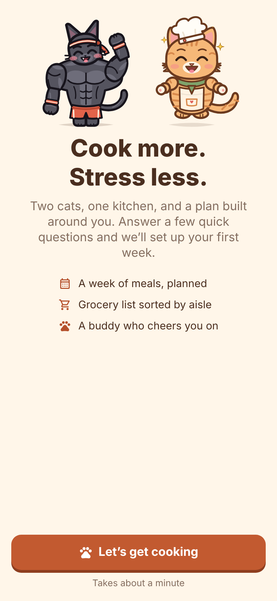
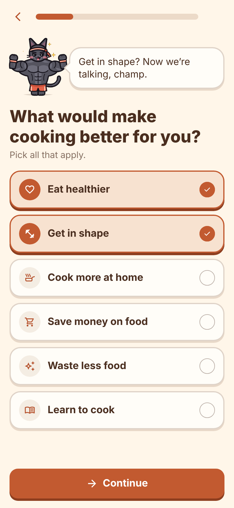
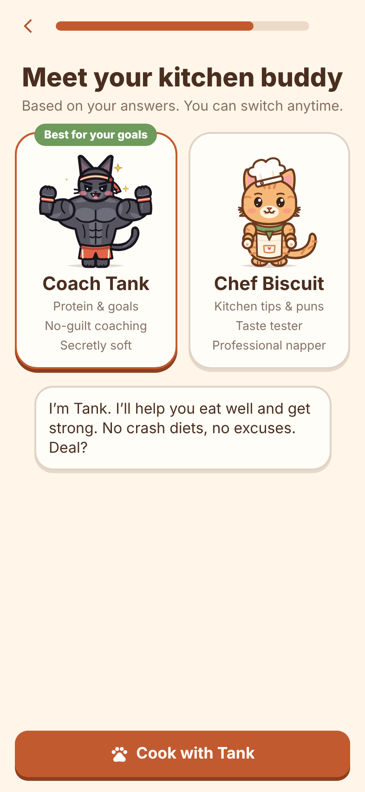
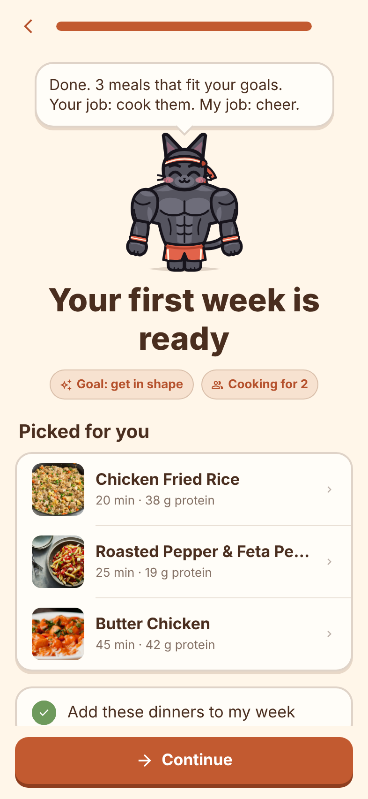
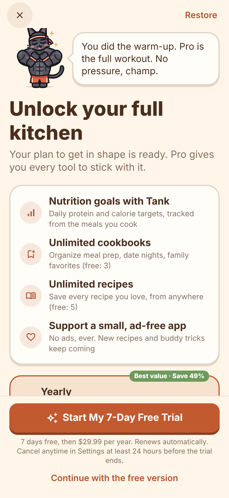

# Recipe App

A cozy recipe manager and meal planner for iPhone, where a cat helps you cook.
Built with Expo (SDK 58), React Native and TypeScript. It runs on mock data for now; there is no backend yet,
but everything you do is saved on the device.

<p>
  
  
  
  
</p>

## Your kitchen buddy

Pick one of two cats when you first open the app. You can switch anytime from the Buddy tab.

| | Personality | Helps with |
| --- | --- | --- |
| **Coach Tank** | Tough but kind. Short sentences, counts everything in reps, never shames food, respects rest days. Secretly soft: gets flustered when you pet him and has a weakness for cookies. | Getting in shape: protein on every card, macros, daily protein and calorie goals, protein tips |
| **Chef Biscuit** | Funny, sweet and clumsy. Drops things, "taste tests" half the ingredients, makes terrible puns, naps in sunny spots. | Making cooking cozy: kitchen tips, encouragement, jokes |

The cats are original vector drawings, rigged like puppets: arms bend at the shoulder and elbow, the tail swishes,
eyes blink and the mouth moves while they talk. Every line they say is tagged with a mood, so the animation matches the words.
For example, Tank flexes when a recipe is high in protein, Biscuit gets a sweat drop when a step says "hot pan", and both stir a bowl during a stirring step.
Tap a cat to pet it.

## Features

- **Recipes:** search, category and diet filters, photo grid, featured "on the menu tonight", pull to refresh
- **Cookbooks:** Favorites plus your own collections; save any recipe to several cookbooks
- **Add your own recipe:** photo, link to the original (Instagram, TikTok, a website), ingredients one per line (amounts are understood), steps, tags
- **Recipe page:** servings scaling, metric/US units (including oven temperatures), nutrition per serving, personal notes, share, buddy comments
- **Cook Mode:** step by step with the screen kept on, timers picked up from the steps ("bake for 25 minutes") that ring with a chime and vibration until you tap Stop, and your buddy acting out each step. Log the meal at the end.
- **Meal plan:** a week view with breakfast, lunch and dinner, a daily nutrition summary, and one tap to add the whole week to your list
- **Groceries:** grouped by aisle, combined across recipes, tick off, swipe to delete, add your own items, share the list
- **Buddy tab:** tricks, switch buddy, cooking streak and stats, daily goals, units

## Onboarding and Pro

<p>
  
  
  
  
  
</p>

New users answer a short quiz (goals, how often they cook, what gets in the way, diet, household),
get a buddy recommended for their goals, watch their plan being built, and see their first week
before any price appears. Every answer is used: plan picks match the diet and goals, recipes open
sized for the household, and the paywall lists the most relevant benefits first.

The flow uses honest persuasion: endowed progress, small commitments, personalization, a recommended
default, a short "building your plan" moment, value before price (reciprocity), a celebrated reveal,
a context-matched paywall, a preselected yearly plan with truthful per-week pricing, and a transparent
trial timeline. It deliberately avoids fake timers or scarcity, invented reviews, guilt-tripping,
hidden prices and hidden close buttons (App Store guideline 3.1.2 and EU consumer law).

| Free | Pro |
| --- | --- |
| Everything else in the app | Unlimited own recipes (free: 5) |
| | Unlimited cookbooks (free: 3) |
| | Daily nutrition goals and tracking |

### Before release: real payments

Purchases are **mocked** so the flow can be tested. To sell Pro:

1. Create the subscriptions (`pro_yearly`, `pro_monthly`) and the free trial in App Store Connect.
2. Replace `purchase` and `restore` in [`src/lib/purchases.ts`](src/lib/purchases.ts) with a real SDK
   (RevenueCat's `react-native-purchases` works well with Expo; it needs a development build, not Expo Go),
   and set `PURCHASES_ARE_MOCK` to `false`.
3. Put your real Terms of Use and Privacy Policy links in the same file. Apple requires both.
4. Prices, trial length and free limits are set in `purchases.ts` and `FREE_LIMITS` in `src/state/store.tsx`.

## Run it

```bash
npm install
npx expo start
```

Scan the QR code with the Camera app to open it in Expo Go on your iPhone, or press `i` for the iOS Simulator (macOS only).

## Project layout

```
src/
  app/                   Screens (Expo Router: every file is a route)
    (tabs)/              Recipes, Plan, Groceries and Buddy, each with its own large-title stack
    onboarding.tsx       Pick your buddy
    recipe/[id].tsx      Recipe page          recipe/new.tsx   Add your own recipe
    cook/[id].tsx        Cook Mode            cookbook/[id].tsx  A cookbook
    plan-picker.tsx, save-to-cookbook.tsx, cookbook-edit.tsx   Sheets
  components/
    cats/                The buddies: art, animation rig, moods, dialogue, speech bubble
  data/mock.ts           Mock recipes, grocery list, plan and cookbooks
  state/store.tsx        App state, saved on the device
  lib/                   Units, ingredient parsing, timers, haptics
  theme/index.ts         All colours, type, spacing, radius and motion
```

## Changing the look

Everything visual lives in [`src/theme/index.ts`](src/theme/index.ts): the cozy light and dark palettes,
Apple's text styles (headings use SF Pro Rounded), spacing, corner radius, the chunky card and button styles, and animation springs.
The cats' colours live with their artwork in [`src/components/cats/art.tsx`](src/components/cats/art.tsx),
and what they say lives in [`src/components/cats/dialogue.ts`](src/components/cats/dialogue.ts).

## Platform notes

The app is designed for iOS. The tab bar, large titles, header search, sheets, haptics and swipe-back are native iOS components,
so they look and behave fully native only on an iPhone. Android and web get working equivalents.

Importing a recipe automatically from a link (like ReciMe does) needs a server, so for now a link is saved with the recipe and you type the details.

## Placeholder photos

The recipe photos in `assets/recipes/` are placeholders from the MIT-licensed
[Foodish](https://github.com/surhud004/Foodish) project, cropped and resized.
Replace them with your own photography before publishing the app.
