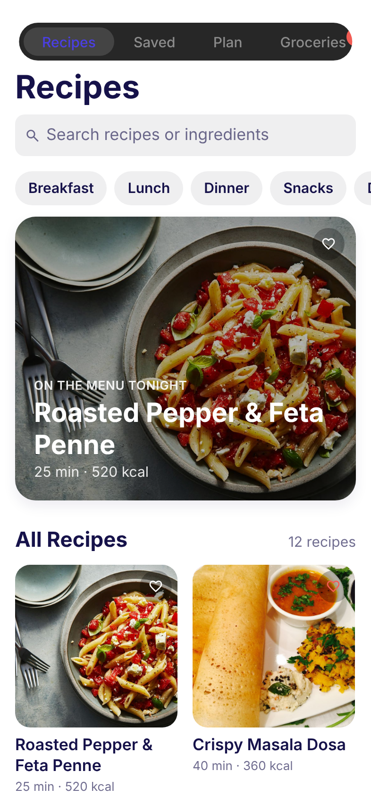
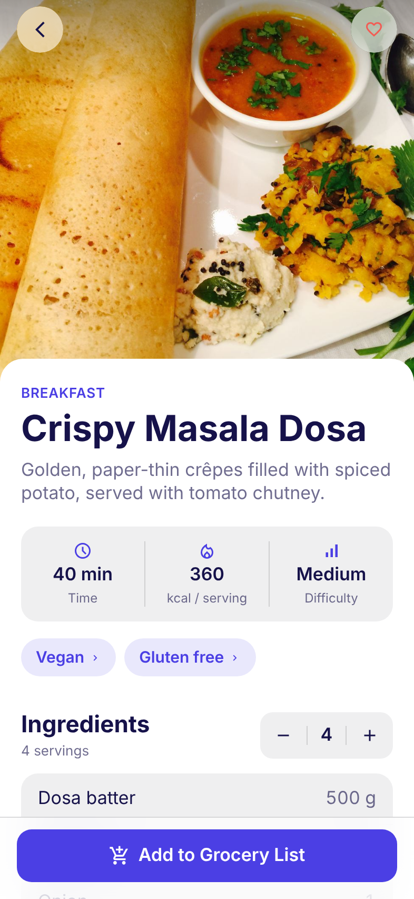
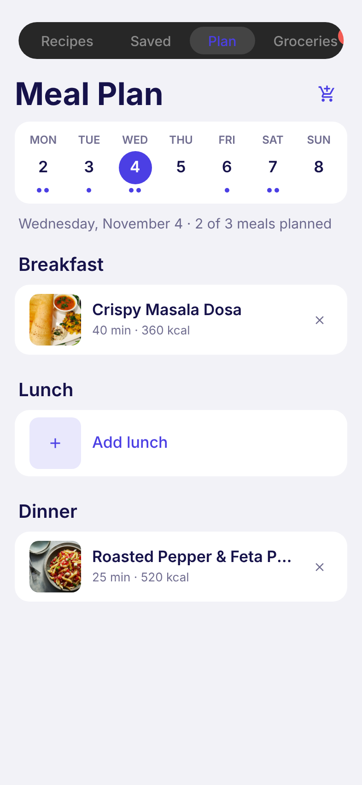
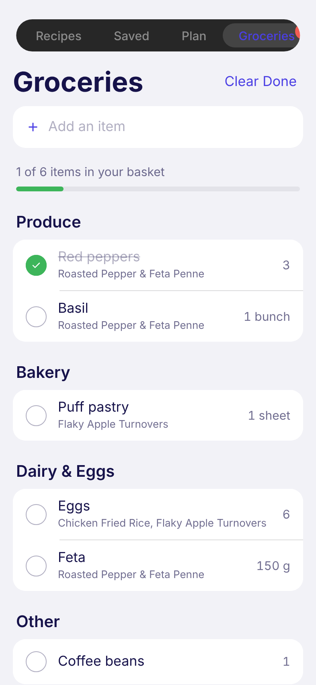

# Recipe App

A recipe manager and meal planner for iPhone, built with Expo (SDK 58), React Native and TypeScript.
It runs on mock data for now; there is no backend yet.

<p>
  
  
  
  
</p>

## Run it

```bash
npm install
npx expo start
```

Scan the QR code with the Camera app to open it in Expo Go on your iPhone, or press `i` for the iOS Simulator (macOS only).

## What's inside

| Tab       | What it does |
| --------- | ------------ |
| Recipes   | Native search bar, category and diet filters, photo grid, pull to refresh, loading skeletons |
| Saved     | Recipes you tapped the heart on |
| Plan      | A week view. Tap a slot to pick a recipe, or the cart button to add the whole week to your list |
| Groceries | Grouped by aisle. Tap to tick off, swipe left to delete, type to add your own items |

The recipe screen has a stretchy hero photo, a servings stepper that rescales every ingredient,
and tags (like **Vegetarian**) that take you back to the list with that filter applied.
Every change shows a short toast, most with **Undo**.

## Project layout

```
src/
  app/                 Screens (Expo Router: every file is a route)
    (tabs)/            The four tabs, each with its own large-title stack
    recipe/[id].tsx    Recipe detail
    plan-picker.tsx    Sheet for choosing a recipe for a meal slot
  components/          Shared UI: buttons, chips, cards, toast, icons
  data/mock.ts         Mock recipes, grocery list and meal plan
  state/store.tsx      App state (favourites, plan, groceries, filters)
  theme/index.ts       All colours, type, spacing, radius and motion
```

## Changing the look

Everything visual lives in [`src/theme/index.ts`](src/theme/index.ts):

- **Colours:** a light and a dark palette built from the brand colours. Change `brand` or the semantic roles below it.
- **Type:** Apple's text styles (Large Title, Headline, Body...). The app uses the iOS system font, SF Pro.
- **Spacing, radius, tap target size and animation springs.**

Icons are defined once in [`src/components/Icon.tsx`](src/components/Icon.tsx), as an SF Symbol for iOS and a Material Symbol for Android and web.

## Platform notes

The app is designed for iOS. These parts use native iOS components, so they only look and behave fully native on an iPhone:
the tab bar, large collapsing titles, the header search bar, the sheet, haptics and swipe-back.
Android and web get working equivalents (the search field and titles are drawn in the page instead).

## Placeholder photos

The recipe photos in `assets/recipes/` are placeholders from the MIT-licensed
[Foodish](https://github.com/surhud004/Foodish) project, cropped and resized.
Replace them with your own photography before publishing the app.
